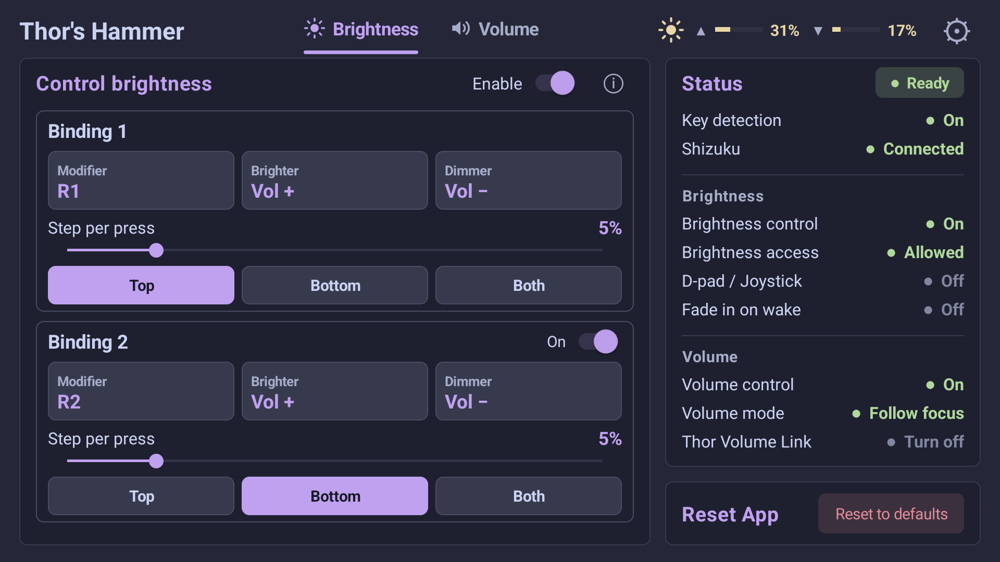
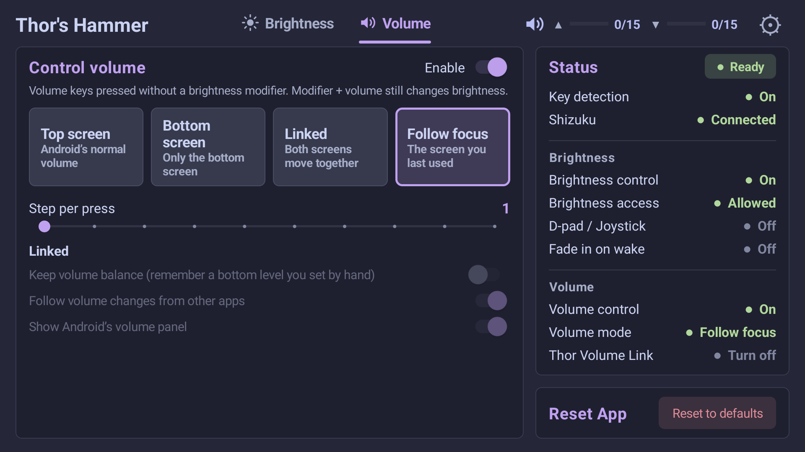

# Thor's Hammer

An unofficial Android utility for the AYN Thor's two screens: controller-driven
**brightness** for each screen, and **volume keys** that can drive the top
screen, the bottom screen, both, or whichever screen you're using. Tested on
the February 2026 Android 13 firmware.

> **Unofficial project:** Thor's Hammer is an independent community utility.
> It is not developed, sponsored, endorsed, or supported by Shenzhen AYN
> Technologies Co., Ltd. AYN and Thor are used only to identify the compatible
> device. All related trademarks belong to their respective owners.




## Credits

Thor's Hammer combines and builds on two MIT-licensed community projects:

- **[Thor's Lightning](https://github.com/HughesTechNZ/Thors-Lightning)** by
  HughesTechNZ: the original brightness app (modifier bindings, dual-screen
  targeting, root/Shizuku D-pad input, service suspension, Sleep/Wake fade).
  Thor's Hammer started as a fork of v1.3.1.
- **[Thor Volume Link](https://github.com/pth2000/ThorVolumeLink)** by the
  Thor Volume Link contributors: the volume-key modes (top, bottom, linked with
  kept balance, and follow focus) are adapted from it.

See [LICENSE](LICENSE) and [THIRD_PARTY_NOTICES.md](THIRD_PARTY_NOTICES.md).
Thor's Hammer's changes were made with assistance from Claude Code and tested
on an AYN Thor.

## Features

### Brightness tab
- **Two bindings, one per screen.** Each binding has its own modifier,
  Brighter and Dimmer controls, step size and screen (Top / Bottom / Both),
  e.g. R1 + Volume for the top screen and R2 + Volume for the bottom. Binding 2
  has its own on/off switch.
- **Tap to record.** Tap Modifier, Brighter or Dimmer and press the control.
  Buttons, volume keys, and (with **Enable D-pad / Joystick**) D-pad or stick
  directions all work.
- **Per-binding steps.** Step per press, plus step per repeat when
  "Same step while holding" is off.
- **Enable switch** turns brightness control on or off.

### Volume tab
- **Enable switch** for volume handling (off by default, so the volume keys
  behave normally until you turn it on).
- **Modes:** Top screen (Android's normal volume), Bottom screen, Linked (both
  screens together, optionally keeping a balance you set by hand), and Follow
  focus (the screen you last used).
- **Step per press** from 1 to 10.
- A brightness modifier + volume still changes brightness; only plain volume
  presses go to the volume mode.
- Bottom-screen volume and follow-focus need **Shizuku** (or root). The top
  screen works without it. If you used Thor Volume Link before, turn off its
  accessibility service so both apps don't react.

### Everywhere
- **Status panel** on both tabs: Ready / Setup needed, key detection and
  Shizuku, then brightness and volume status.
- **Header** shows live levels for the open tab (brightness % or volume) and
  a settings gear.
- **Settings** (gear): repeat speed, Sleep / Wake fade-in and long-close reset,
  and Input (Shizuku/root, D-pad / Joystick, suspend conflicting services,
  reserve modifier buttons).
- **Bottom-screen level sync:** brightness and volume changes on the bottom
  screen are written back to AYN's settings so AYN's own controls stay in step.
- **Reset App** restores defaults while keeping permissions and setup.
- Catppuccin Macchiato theme, subtle haptics, no click sounds, controller
  focus rings.

## Brightness behavior

When **Both** is selected, Thor's Hammer adjusts the top and bottom screens
relative to their current brightness. Each press applies the same step to each
screen, so if the top screen is brighter than the bottom screen, it stays
brighter while both move up or down together.

## Requirements

- AYN Thor running the compatible Android 13 firmware
- Accessibility service enabled for Thor's Hammer
- Android "Modify system settings" permission
- Shizuku or root for: D-pad / stick bindings, suspending other services,
  bottom-screen volume, and follow focus

Root/Shizuku axis input has platform limits: D-pad and stick directions may
still reach games, so use buttons or volume keys when full reservation matters.

## Installation

1. Install the APK from the latest GitHub release.
2. Open **Thor's Hammer**; the setup popup walks you through **Modify system
   settings** and the **Thor's Hammer controls** accessibility service.
3. Optional: connect Shizuku (or allow root) from **Settings → Input**, then
   turn on **Enable D-pad / Joystick** to record D-pad or stick directions.
4. On the **Brightness** tab, tap each control of a binding to record it and
   pick its screen. Turn on Binding 2 for the other screen.
5. Optional: on the **Volume** tab, turn on **Enable** and pick a mode.
6. Optional: **Settings → Sleep / Wake** for the fade-in on wake.

## Building

The project uses Gradle 9.7.1 / AGP 9.4.0 and needs JDK 17 or newer (Android
Studio's bundled JBR works) and Android SDK 35.

```bash
./gradlew :app:test :app:assembleRelease
```

The release build currently uses the Android debug signing key for direct
installation and update testing.

## Support scope

This app depends on AYN's dual-display Android behavior and Android's handling
of controller, accessibility, and rooted input events. Future firmware may
change those internals. Please include the device firmware version, root state,
selected mappings, screen target, and whether the issue happens in non-root or
root mode when reporting a problem.

## Development disclosure

This project was created under human direction with assistance from OpenAI
Codex. AI assistance was used for portions of the code, documentation, build
automation, icon generation, and test workflow. The device-specific behavior
and release APK were reviewed and tested by the project owner on real AYN Thor
hardware.

AI-assisted output can contain mistakes. Review the source and understand the
accessibility and optional root-input behavior before installing or modifying
the project.

## Changelog

### v1.0

- Initial public release.

### v1.1

The main focus of this update is handling conflicts with other controller-related
apps. If another app responds to the same buttons, brightness and volume could
change at the same time. Thor's Lightning can now temporarily suspend multiple
selected accessibility services while the modifier is held, then restore them
afterward.

Additional improvements:

- Improved first-time setup with a guided welcome and clearer permission steps.
- Clearer button-mapping layout with the assigned control highlighted below its
  function.
- Amber **- Needed** and green **- Enabled** setup indicators.
- Improved spacing, text wrapping, and button sizing to prevent clipped labels.
- Separate brightness steps for individual presses and repeated holds.

### v1.2

- Improved root input detection so D-pad, L-stick, and R-stick directions are
  identified correctly when recording brightness controls.
- Enabling **Enable D-pad / Joystick** turns on exclusive root-axis mode:
  regular button and volume mappings are suppressed while D-pad or stick
  brightness input is selected, preventing both paths from changing brightness
  at the same time.
- Root directional mappings now work for Bright and Dimmer controls, while
  directional inputs are kept out of the modifier role.
- Added clearer recording safeguards when the required permissions are not yet
  enabled, plus clearer guidance around root-input and reservation limits.
- Improved duplicate mapping handling so assigning an already-used button swaps
  the existing mapping cleanly.
- Refined spacing, text wrapping, setup status, and root-options presentation
  for better readability on Thor's three-button navigation layout.
- Enabled Android immersive mode to keep the navigation bar from interfering
  with the app layout and avoid GUI rendering issues.

### v1.3

- Added configurable Sleep/Wake brightness behavior with a short black hold and
  smooth ramp back to each screen's saved level.
- Added optional long-close reset behavior with a 0-minute to 24-hour timeout
  and configurable reset brightness.
- Improved independent top/bottom brightness capture during Thor lid and sleep
  transitions.
- Reworked Sleep/Wake settings into grouped, rounded sections with clearer
  explanations and safer enable/save behavior.
- Updated first-run conflict messaging to explain when root is required for
  suspending another accessibility service.
- Refined layout spacing, immersive popup behavior, default timing values, and
  setup text for the current Thor display and navigation layout.

### v1.3.1

- Added Shizuku as an alternative to Root for D-pad/joystick input and
  temporarily suspending conflicting accessibility services.
- Added an in-app Shizuku authorization prompt with automatic status updates
  after approval or denial.
- Privileged controls now reset safely if Root/Shizuku access is later lost.
- Gated Sleep/Wake brightness and service selection until required permissions
  are configured, with clearer, shorter warnings.

### v1.4.0 (Thor's Hammer)

- Second binding with its own modifier, controls and screen target.
- Catppuccin Macchiato redesign with first-run setup popup and status header.
- Simpler Fade in on wake toggle with a compact Fade settings popup.
- Compact, cancellable record popup.
- Reset App button, subtle haptics, no click sounds.
- Gradle 9.7.1 / AGP 9.4.0.
- Volume tab with Thor Volume Link's top / bottom / linked / follow-focus modes.
- Renamed to Thor's Hammer; Status panel on both tabs, per-tab Enable switches,
  underline tabs and tab-aware header levels.

## License

Thor's Lightning's original source and icon are available under the
[MIT License](LICENSE). Third-party components retain their own licenses.
